<a href="https://hadesflow.com">
  <picture>
    <source media="(prefers-color-scheme: dark)" srcset="assets/hero-dark.svg">
    
  </picture>
</a>

<p align="center">
  <b>AI automation agency from Sofia, Bulgaria.</b><br>
  Custom software, AI automations and AI agents - we build them, host them and keep them running.<br>
  And we train your team, too.
</p>

```yaml
# cerberus.yml - three heads, one job: your work keeps flowing
build:  custom software, AI automations, AI agents
host:   on infrastructure we set up and manage for you
run:    monitoring, updates and support - critical issues answered within 2h

stack:  [n8n, Claude, OpenAI, Gemini, Docker, PostgreSQL, Redis, Grafana, Cloudflare]
```

<p align="center">
  <sub><b>HOW IT WORKS</b></sub><br>
  Free call &nbsp;→&nbsp; Written proposal &nbsp;→&nbsp; Agreement &nbsp;→&nbsp; Build &amp; launch &nbsp;→&nbsp; We run it
</p>

<p align="center">
  <a href="https://hadesflow.com/contact.html"></a>
</p>

<p align="center">
  <a href="https://hadesflow.com">hadesflow.com</a> &nbsp;·&nbsp;
  <a href="https://hadesflow.com/blog.html">Blog</a> &nbsp;·&nbsp;
  <a href="https://www.linkedin.com/company/hadesflow/">LinkedIn</a> &nbsp;·&nbsp;
  <a href="mailto:contact@hadesflow.com">contact@hadesflow.com</a>
</p>
